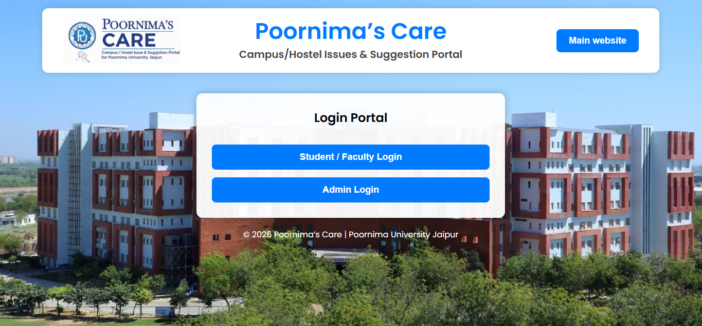
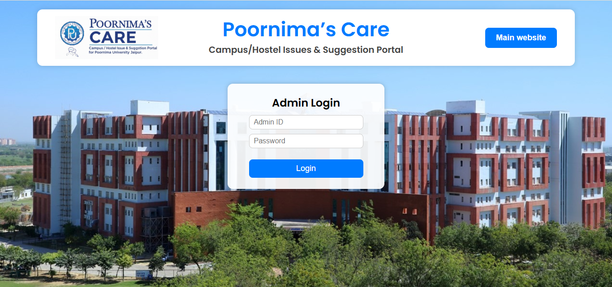
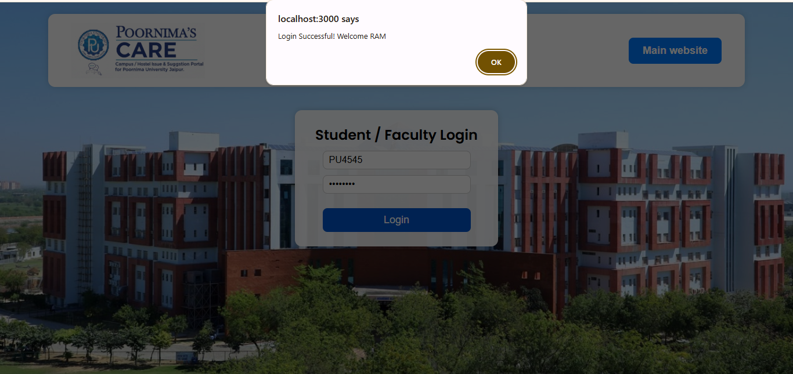
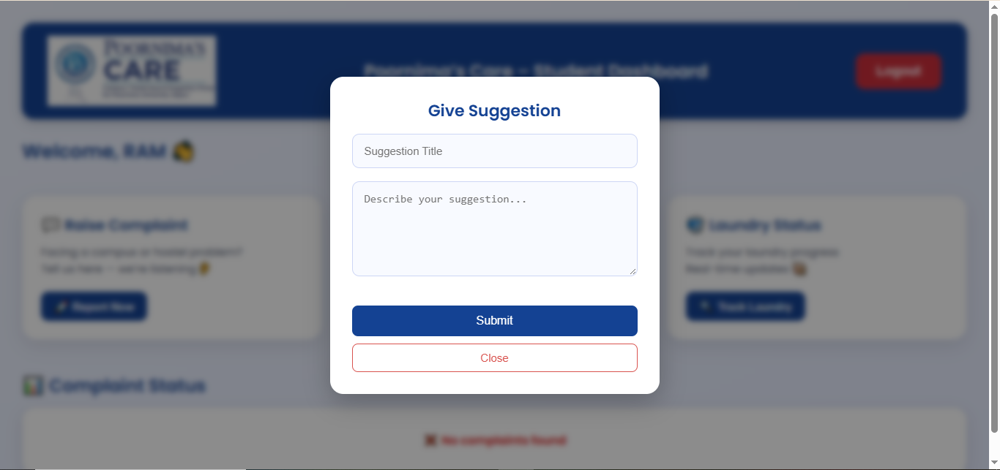
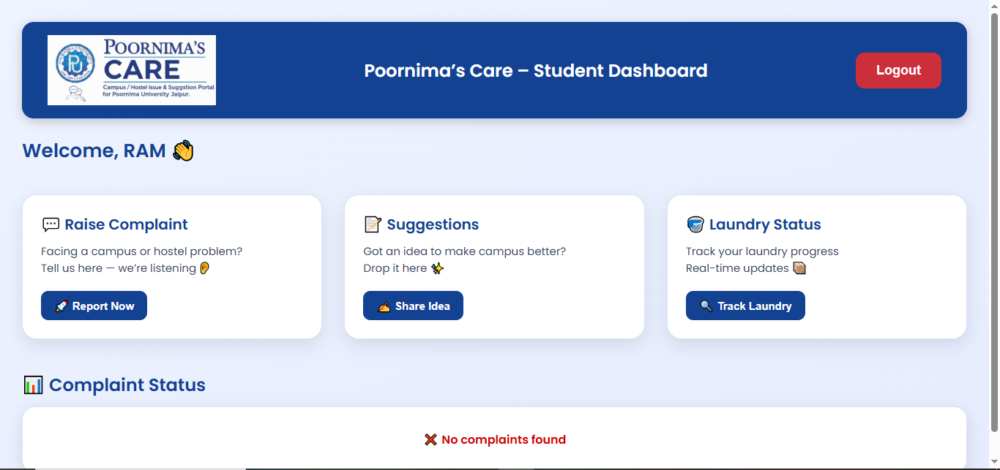
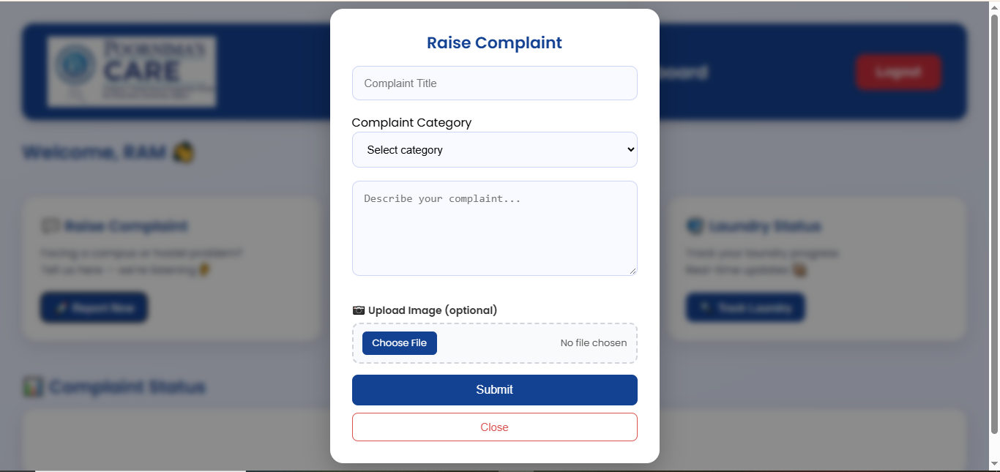
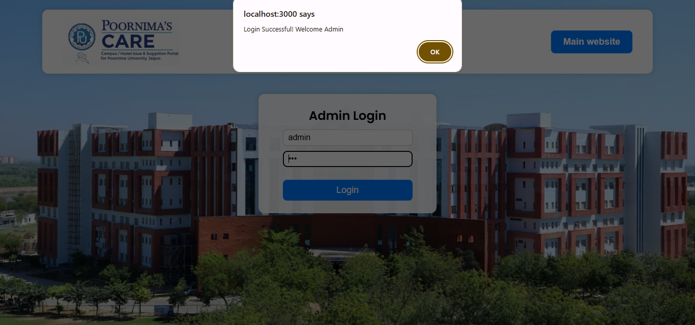
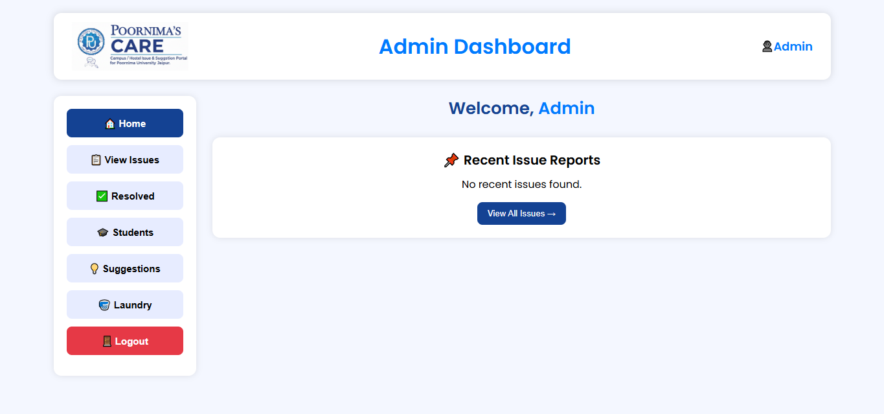

# 🏫 Poornima's Care

**Campus / Hostel Issues & Suggestion Portal** for Poornima University, Jaipur.

Poornima's Care gives students and faculty one place to report campus or hostel problems, share suggestions, and check on their laundry, while giving administrators a dashboard to track and resolve everything.

> Built by **Team DeepDivers**.

---

## ✨ Features

### 🎓 Student / Faculty
- **Raise a complaint** with a category, description, and an optional photo as proof
- **Track complaint status** (`Pending` → `In Progress` → `Resolved`)
- **Submit suggestions** to improve campus life
- **Laundry tracker** – look up a bag by its ID and see its stage (`collected` → `washing` → `ironing` → `ready`)

### 🛠️ Admin
- **Dashboard overview** with Pending / Resolved / Total counts and recent reports
- **View and manage issues** – update status as work progresses
- **Resolved issues** archive
- **Students** section
- **View suggestions** submitted by users
- **Laundry management** – add bags and update their status

---

## 📸 Screenshots

### Home


### Student / Faculty Login


### Admin Login


### Student Dashboard


### Raise a Complaint


### Give a Suggestion


### Laundry Tracker


### Admin Dashboard


### Admin Laundry Panel


---

## 🧰 Tech Stack

| Layer | Technology |
|-------|------------|
| Frontend | React 19, React Router 7, Create React App |
| Backend | Node.js, Express 4 |
| Database | MongoDB (via Mongoose) |
| File uploads | Multer (issue images stored in `backend/uploads/issues`) |
| Firebase | Hosting config and Firestore / Storage SDK setup |
| Other | `xlsx` for spreadsheet handling |

---

## 📁 Project Structure

```
poornima-care/
├── backend/
│   ├── middleware/        # Multer image-upload config
│   ├── models/            # Mongoose schemas: Issue, Suggestion, Laundry
│   ├── routes/            # issueRoutes, suggestionRoutes, laundryRoutes
│   ├── uploads/           # Uploaded issue images (git-ignored)
│   ├── .env.example       # Template for environment variables
│   └── server.js          # Express entry point
├── docs/
│   └── screenshots/       # Images used in this README
├── public/                # Static assets for CRA
├── src/
│   ├── assets/            # Logo and background images
│   ├── App.js             # Routes
│   ├── api.js             # Backend base URL
│   ├── firebase.js        # Firebase initialisation
│   ├── StudentFacultyLogin.js / StudentFacultyDashboard.js
│   ├── AdminLogin.js / AdminHome.js
│   ├── AdminViewIssues.js / AdminResolved.js
│   ├── AdminStudents.js / AdminViewSuggestions.js
│   ├── AdminLaundry.js / LaundryPage.js
│   └── ComplaintStatus.js
├── .env.example           # Frontend env template (API URL)
├── firebase.json
├── firestore.rules
└── package.json
```

---

## 🚀 Getting Started

### Prerequisites
- [Node.js](https://nodejs.org/) v18 or later
- [MongoDB](https://www.mongodb.com/) (local install or a free [MongoDB Atlas](https://www.mongodb.com/atlas) cluster)
- npm (comes with Node.js)

### 1. Clone the repository
```bash
git clone https://github.com/<your-username>/<your-repo-name>.git
cd <your-repo-name>
```

### 2. Set up the backend
```bash
cd backend
npm install
cp .env.example .env      # on Windows: copy .env.example .env
```
Open `backend/.env` and fill in your values:
```env
MONGO_URL=your_mongodb_connection_string
PORT=5000
```
Start the server:
```bash
npm start          # or: npm run dev   (requires nodemon)
```
The API will be running at `http://localhost:5000`.

### 3. Set up the frontend
In a **new terminal**, from the project root:
```bash
npm install
cp .env.example .env      # on Windows: copy .env.example .env
```
`.env` tells the frontend where your backend lives (defaults to `http://localhost:5000/api`):
```env
REACT_APP_API_URL=http://localhost:5000/api
```
Then start the app:
```bash
npm start
```
Open [http://localhost:3000](http://localhost:3000).

### 4. Firebase (optional)
Replace the config object in `src/firebase.js` with your own project's keys from the [Firebase Console](https://console.firebase.google.com/) (Project settings → Your apps).

---

## 🔌 API Reference

Base URL: `http://localhost:5000/api`

### Issues – `/issues`
| Method | Endpoint | Description |
|--------|----------|-------------|
| `POST` | `/add` | Create an issue (multipart form-data, optional `image` file) |
| `GET` | `/all` | List all issues |
| `GET` | `/resolved` | List resolved issues |
| `PUT` | `/update-status/:id` | Update an issue's status |

### Suggestions – `/suggestions`
| Method | Endpoint | Description |
|--------|----------|-------------|
| `POST` | `/add` | Submit a suggestion |
| `GET` | `/all` | List all suggestions |

### Laundry – `/laundry`
| Method | Endpoint | Description |
|--------|----------|-------------|
| `POST` | `/add` | Add a bag or update its status |
| `GET` | `/all` | List all bags |
| `GET` | `/:bagId` | Get one bag by ID |

---

## 🗄️ Data Models

- **Issue** – `studentName`, `enrollment`, `category`, `message`, `imageUrl`, `status`, `createdAt`
- **Suggestion** – `title`, `description`, `userName`, `userId`, `createdAt`
- **Laundry** – `bagId` (unique), `student`, `status`, timestamps

---

## 📜 Available Scripts

**Frontend** (project root)

| Command | What it does |
|---------|--------------|
| `npm start` | Runs the app in development mode on port 3000 |
| `npm run build` | Creates a production build in `build/` |
| `npm test` | Runs the test runner |

**Backend** (`/backend`)

| Command | What it does |
|---------|--------------|
| `npm start` | Starts the Express server |
| `npm run dev` | Starts the server with auto-reload (nodemon) |

---

## ☁️ Deployment

The frontend is configured for **Firebase Hosting** (`build/` is the public directory).

```bash
npm run build
npm install -g firebase-tools
firebase login
firebase deploy --only hosting
```

The backend must be hosted separately (for example Render, Railway, or a VPS), with `MONGO_URL` set as an environment variable. Set `REACT_APP_API_URL` to the deployed backend URL before building.

---

## 🛣️ Roadmap

- [ ] Replace the static login data with real authentication (e.g. Firebase Auth or JWT)
- [ ] Tighten Firestore security rules
- [x] Move the API base URL to an environment variable (`REACT_APP_API_URL`)
- [ ] Email / push notifications when an issue's status changes
- [ ] Analytics charts on the admin dashboard

---

## 🤝 Contributing

1. Fork the repository
2. Create a feature branch: `git checkout -b feature/your-feature`
3. Commit your changes: `git commit -m "Add your feature"`
4. Push to the branch: `git push origin feature/your-feature`
5. Open a Pull Request

---

## 👥 Team DeepDivers

Add your team members here:

| Name | Role | GitHub |
|------|------|--------|
| _Your Name_ | _Role_ | [@username](https://github.com/username) |

---

## 📄 License

Add a license of your choice (e.g. [MIT](https://choosealicense.com/licenses/mit/)), or remove this section.

---

© Poornima's Care | Poornima University, Jaipur
